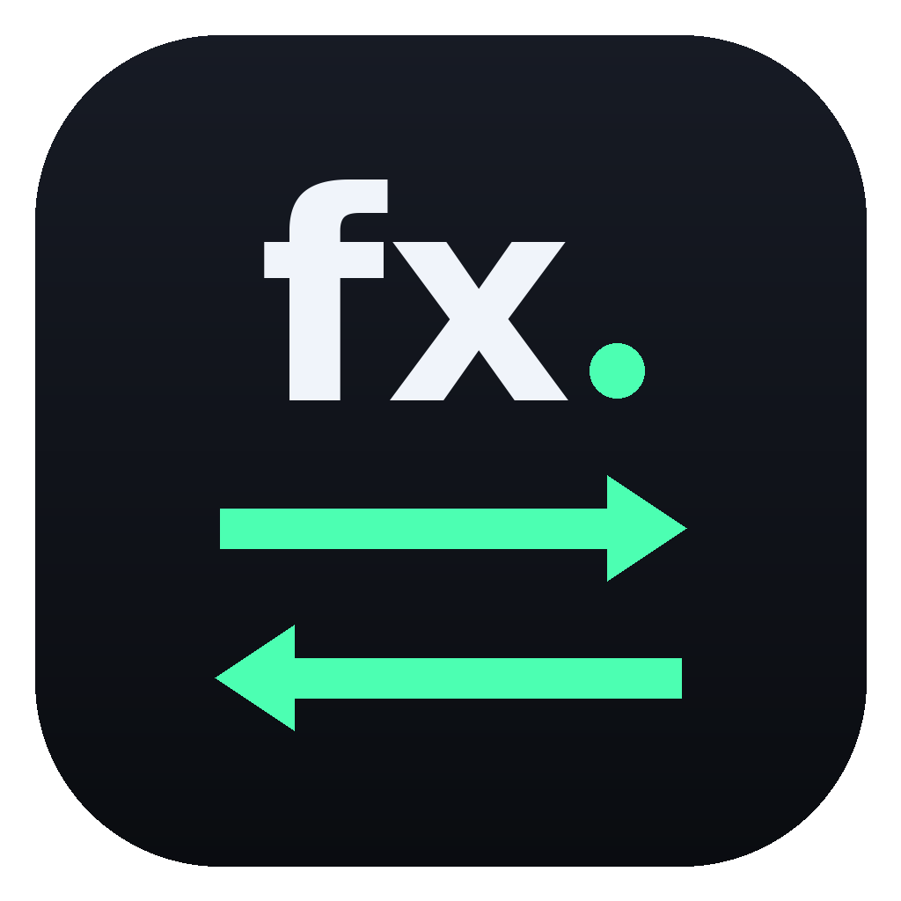

<h1 align="center">FX Manual</h1>

  Калькулятор обмена валют по курсу, который вы видите на табло обменника. 
  Currency exchange calculator using the rate on the exchange office board.

  <a href="https://github.com/Finn013/FXManual/releases/latest">Скачать / Download</a> ·
  <a href="https://finn013.github.io/FXManual/">Открыть онлайн / Open online</a>

---

## 🇷🇺 О приложении
Стоите возле обменника и хотите быстро понять, сколько получите? Введите сумму и курс с табло — FX Manual сразу посчитает. Никаких онлайн-курсов и интернета: только ваш курс и ваша сумма.

### Возможности
- Сумма, «Отдаю» и «Получаю», кнопка ⇄ чтобы поменять валюты местами.
- Курс вводится вручную за 1 единицу отдаваемой валюты.
- Комментарий к расчёту, например «обменник на вокзале».
- Свой список валют: добавляйте и удаляйте нужные.
- История расчётов с очисткой.
- Три темы: тёмная, светлая и фиолетовая.
- Всё хранится на устройстве, работает без интернета.

### Скачать
| Платформа | Файл |
|---|---|
| Любое устройство с браузером | `FXManual.html` |
| Android 7+ | `FXManual.apk` |
| iPhone, iPad, Mac | [finn013.github.io/FXManual](https://finn013.github.io/FXManual/) — Safari → «На экран Домой» |

---

## 🇬🇧 About
Standing next to an exchange office and want to know how much you’ll get? Enter the amount and the rate from the board — FX Manual calculates it instantly. No online rates, no internet: just your rate and your amount.

### Features
- Amount, “I give” and “I get”, ⇄ button to swap currencies.
- Manual rate per 1 unit of the currency you give.
- Optional comment, e.g. “station exchange office”.
- Your own currency list: add and remove.
- Calculation history with clear.
- Three themes: dark, light and purple.
- Everything stays on the device, works offline.

### Download
| Platform | File |
|---|---|
| Any device with a browser | `FXManual.html` |
| Android 7+ | `FXManual.apk` |
| iPhone, iPad, Mac | [finn013.github.io/FXManual](https://finn013.github.io/FXManual/) — Safari → “Add to Home Screen” |
